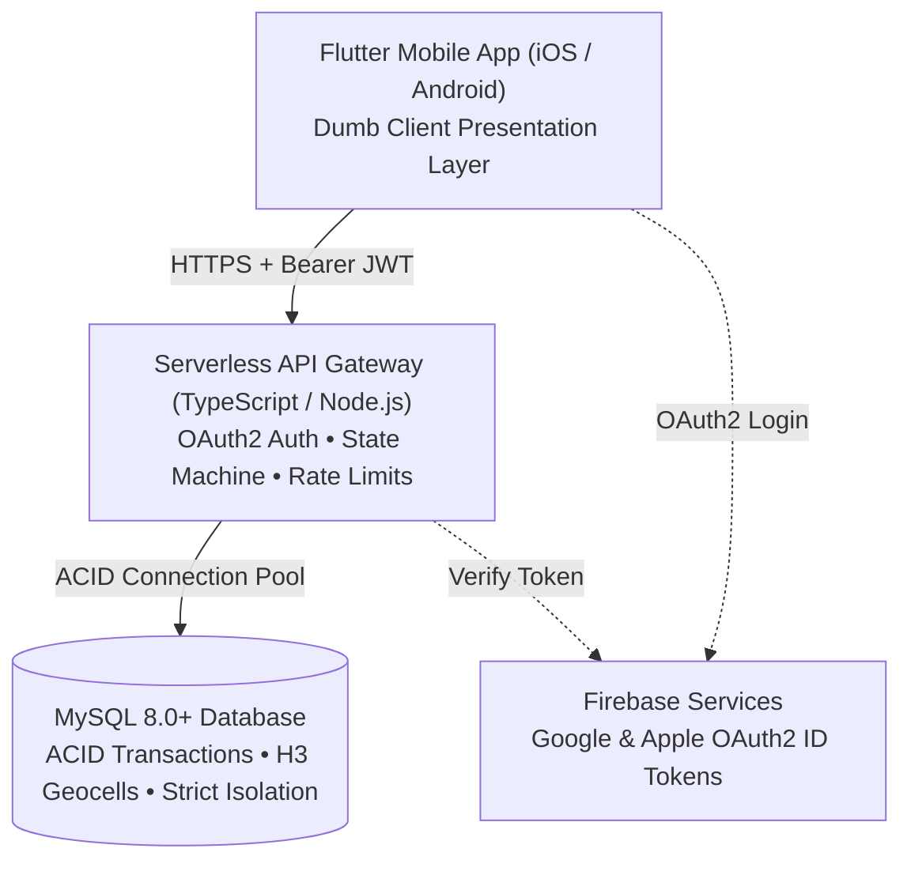
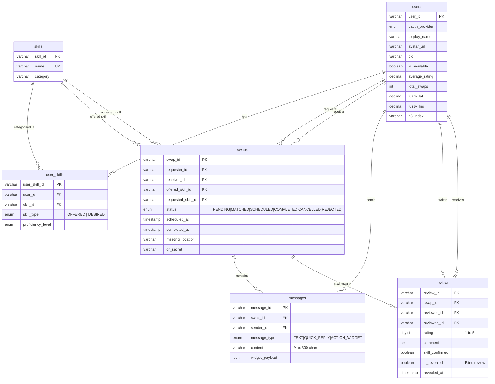
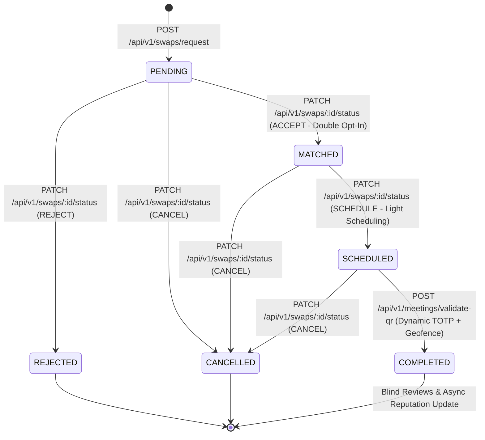

# Trueqer: System Architecture & Data Model

## 1. System Overview

Trueqer is a peer-to-peer two-sided market platform for swapping skills and knowledge without monetary exchange.



---

## 2. Relational Data Model (MySQL 8.0+)

The relational model implements strict 3NF structure, ACID transactional consistency, and cascade purges for GDPR:



---

## 3. Privacy & Geospatial Architecture ([REQ-06])

- **No Continuous Tracking**: Background GPS monitoring is strictly prohibited.
- **No Exact Coordinates Stored or Shared**: User residence coordinates are truncated to 2 decimal places (`fuzzy_lat`, `fuzzy_lng`, ~1.1 km precision).
- **Uber H3 Indexing**: Location resolution is indexed using Uber H3 hexagonal cells. Neighbor search queries run as simple SQL lookups:
  ```sql
  SELECT * FROM users WHERE h3_index IN ('882a1072b7fffff', '882a1072b5fffff') AND is_available = TRUE;
  ```

---

## 4. Finite State Machine & Proof-of-Meeting Flow



---

## 5. Security & Isolation Matrix

| Capability | Mobile Client (Flutter) | API Gateway (Serverless) | MySQL Database |
| :--- | :---: | :---: | :---: |
| Direct DB Connection | ❌ Strictly Prohibited |  VPC Connection Pool | N/A |
| Business Logic Enforcement | ❌ Dumb presentation |  Authoritative | ❌ Enforces schema/FKs |
| TOTP Validation | ❌ Camera Scan Only |  Cryptographic HMAC | ❌ Raw Secret Storage |
| GDPR Cascade Purge | ❌ HTTP Trigger |  ACID Transaction |  ON DELETE CASCADE |
| State Transition Control | ❌ Request Only |  Strict Guards | ❌ State column |
